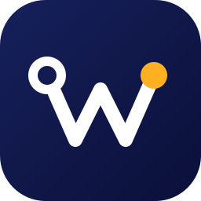
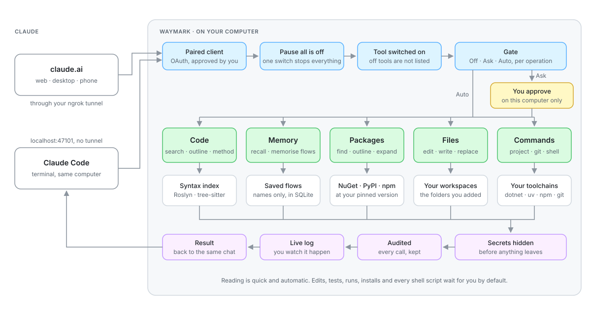

<p align="center">
  
</p>

<h1 align="center">Waymark</h1>

<p align="center">
  <b>Give Claude your real codebase, not a guess of it.</b><br>
  Verified package APIs, a memory of how your code flows, and commands that wait for you.<br>
  From claude.ai or Claude Code, on your own Windows or Mac.
</p>

<p align="center">
  
  
  
  
  
</p>

<p align="center">
  <a href="#quick-start">Quick start</a> ·
  <a href="#what-changes-when-claude-has-waymark">What it does</a> ·
  <a href="#why-not-just-use-claude-code">Why not just Claude Code?</a> ·
  <a href="#safety-model">Safety</a> ·
  <a href="#all-35-tools">All tools</a> ·
  <a href="docs/">Docs</a>
</p>

> [!WARNING]
> **Read this first.** Waymark gives an AI assistant real access to this computer. What it reads can reach your Claude chat, and what it runs acts as you. Changes and commands wait for your approval by default, approvals can only be given on this computer, and secrets in tool results are hidden before they leave. None of that is perfect, so read [docs/safety.md](docs/safety.md) before you install, and see [SECURITY.md](SECURITY.md) to report a problem. This is early software, provided as is under the [MIT License](LICENSE).


---

## In one paragraph

Waymark is a local [MCP](https://modelcontextprotocol.io) server that runs on your computer and lets Claude work across all your repositories in one conversation. It reads C#, Python, TypeScript and JavaScript through a syntax index, so Claude reads an outline and one method instead of whole files. It checks NuGet, PyPI and npm APIs against the exact versions your lock files pin, so Claude stops inventing methods. It **remembers how each feature flows** through your code, so the next chat starts where the last one stopped. And it builds, tests and runs your projects through typed commands that you approve, on your machine, with every call audited.

## What changes when Claude has Waymark

| Without it | With Waymark |
|---|---|
| Claude guesses a package's API from training data, often the wrong version. | `pkg_find` reads the real package at the version your project pins. A member that isn't confirmed there **does not exist**. |
| Every new chat re-explores the same feature: search, open, read, repeat. | Claude saves each feature as a **flow** (trigger → ordered method steps → outcome). Next time, one `recall` call gives the path. |
| Reading code means reading whole files. | `code_skeleton` → `code_search` → `code_outline` → `code_method`: overview, find, structure, one body with real line numbers. |
| Searching only works if you know the name. | `code_search` finds code **by what it does** (`refresh token rotate`), ranked, with the words each hit matched. |
| Find-and-replace across files is all trust. | `file_replace` previews a plan first, then applies all or nothing, refused if anything changed since. |
| A backend, a frontend and a worker means three chats. | One conversation, every workspace. Search them all at once, copy code between them on the server. |
| An agent with a shell can do anything, silently. | Typed actions with Off / Ask / Auto gates, approvals only on your machine, secrets hidden, a live log and an audit trail. |

## How a session looks

<p align="center">
  
</p>

---

## Quick start

**Windows 10/11**

```powershell
git clone https://github.com/patilprashant6792-official/waymark-local.git
cd waymark-local
install.cmd
```

**macOS 14+ (Apple silicon or Intel).** Keep the clone outside Documents, Desktop and Downloads ([why](#macos-folder-access)).

```bash
mkdir -p ~/source && cd ~/source
git clone https://github.com/patilprashant6792-official/waymark-local.git
cd waymark-local
bash install.sh
```

The admin page opens at <http://localhost:47100>. Then:

1. **Workspaces:** add a project folder Claude may read.
2. **Connect Claude:**
   - **Claude Code** (no tunnel): `claude mcp add --transport http waymark http://localhost:47101/mcp`, then approve the pairing on **Approvals**.
   - **claude.ai**: set up the tunnel once ([steps below](#connect-claudeai-with-ngrok)), add the connector address in claude.ai, and approve the pairing code.
3. Ask Claude something about your code. Watch it on **Live**. **Pause all** in the header stops every tool at once.

Linux is not supported.

---

## Features

### 🧭 Memory: flows

A **flow** is one trigger (an endpoint, a tool, a queue message, a button) to one outcome, saved as the ordered methods a request passes through. Claude saves and updates flows on its own as it works.

```text
## Flow 'recall-list' (id 41, v4)
5 steps. Links: 4 call it, 0 by name only, 0 declared, 0 do not call.

 1. Tools/MemoryTools.cs:MemoryTools.Recall                             [trigger]
 2.   Memory/FeatureMemoryService.cs:FeatureMemoryService.ListAsync     [calls it]
 3.     Memory/FlowRecallService.cs:FlowRecallService.ListAsync         [calls it]
 4.       Stores/FeatureMapStore.cs:FeatureMapStore.ListAsync           [calls it]
 5.       Memory/FlowRecallRenderer.cs:FlowRecallRenderer.List          [calls it]
```

- **Names, never code.** A flow survives edits and branch switches. A step missing on the current branch is shown as `NOT ON THIS BRANCH (kept)`, not deleted.
- **Links are checked** against the parsed calls. `[DOES NOT CALL]` means the flow is wrong.
- **Edits warn when they break a flow.** File edits, moves and deletes add a 🧭 line so Claude fixes the flow in the same task.
- **Visible and yours.** Each workspace has a Flows page with the step tree; export and import flows with your workspaces and access rules as one file.

### 📦 Real package APIs

| Ecosystem | Read from | Versions from | Docs from |
|---|---|---|---|
| NuGet | the compiled assemblies | `.csproj`, `Directory.Packages.props` | XML doc comments |
| PyPI | the wheel and its stub package | `uv.lock`, `poetry.lock`, `pdm.lock` | docstrings |
| npm | declaration files or `@types` | `package-lock.json`, `pnpm-lock.yaml`, `yarn.lock` | JSDoc |

Downloads use HTTPS, integrity hashes are checked where the registry publishes them, the package is indexed locally, and the download is deleted. Nothing is installed, imported or run.

### 🔎 Your code, by name or by meaning

- **Roslyn** for C#, **tree-sitter** for Python, TypeScript and JavaScript. Parse-only: nothing is compiled or executed.
- **Search by description:** split names, doc comments, paths and up to 64 words from each member's body, with stemming, ranking, `"phrases"`, `+required` and `-excluded`. The index stores words, never lines of code.
- **Across workspaces:** `code_search('*', ...)` finds a C# backend and a Python service together. Claude searches every casing of a name that crosses a boundary (`TotalAmount`, `totalAmount`, `total_amount`).
- **React-aware:** handlers, `useCallback`s and inner helpers inside a component are indexed as local members, so Claude reads `handleSave` without the other 1,900 lines.
- **Callers and implementers:** `code_callers` and `code_types` for impact before a change.

### ✏️ Edits you can trust

- `file_edit_lines` and `file_write` change files (off until you switch them on). They can **copy instead of retype**: lines, files or whole folder trees, also between workspaces, with renames, previewed with `dryRun`.
- `file_replace` previews a plan (files, matches, count), then applies it with the plan id and count. Plans are single-use, expire after 10 minutes, and are refused if any file changed. A C# mode touches only identifiers. Encoding, BOM and line endings are kept. A replacement that would write a new secret is refused.
- Atomic writes keep file metadata: ACLs and creation time on Windows, permission bits on macOS.

### ▶️ Build, test, run: typed, not typed-into-a-terminal

| Toolchain | Actions |
|---|---|
| .NET | build, rebuild, test, format, restore, list (outdated / vulnerable packages), new, sln, reference, package add/remove, EF Core migrations and database update, run |
| Python (uv or pip) | info, venv, install, test (pytest), lint and format (ruff), type check (pyright or mypy), run, package add/remove |
| Node (npm) | info, install, type check (tsc), build, test, lint, any `package.json` script, run, package add/remove |
| git | status, diff, log, show, branches, add, commit, branch, stash, restore, pull (fast-forward), push. Never force-push. |
| Processes | ports, stop a port, build servers, clean bin/obj |
| Shell | PowerShell, cmd, zsh or bash for anything else. **Always** asks; you can edit the script before approving. |

Claude fills in an action, its options and a one-line purpose. Waymark builds the real command line, and the purpose is shown on your approval card.

### 🖥️ The admin UI

A live log of every call as it happens, one inbox for approvals, a side panel with the full input and output of any call, the Flows page, Packages, Workspaces, Commands gates, Safety, Audit with retention settings, and Setup for the tunnel. The browser tab shows a dot when something is waiting for you.

---

## Why not just use Claude Code?

Use both. Waymark is an MCP server, and Claude Code connects to it locally in one command. Here's what each brings, honestly:

| | Claude Code alone | Claude Code or claude.ai + Waymark |
|---|---|---|
| Read and edit local files, run commands | ✅ | ✅ through typed tools with gates |
| Works from claude.ai on the web, desktop and phone | — | ✅ via your own tunnel |
| One conversation across many repos | in one working folder at a time | ✅ every workspace, searched together |
| Package APIs checked at your pinned version | — | ✅ NuGet, PyPI, npm |
| Memory of how features flow, checked against the code | `CLAUDE.md` notes you maintain | ✅ flows Claude keeps and Waymark verifies |
| Token-efficient reading (outline → one method) | reads files | ✅ syntax index |
| Per-operation Off / Ask / Auto, approvals on the machine, secret hiding, audit trail | permission prompts in the terminal | ✅ |

---

## Safety model

Waymark has **no sandbox**. Its job is to limit, show and record what Claude does on your real machine.

- **Approvals happen only on this computer.** Claude cannot approve, deny or change a gate. Pairing a new Claude client also needs your approval.
- **Gates per operation:** Off (refused), Ask (waits for you) or Auto. Tests, runs, scripts, installs and package changes ask by default. Every shell script always asks. `git reset --hard`, `clean` and branch delete are off.
- **Installs run no package code.** Python installs are wheels only and never build the project. Node installs are `npm ci --ignore-scripts`. Requirements files are checked first: editable installs, paths, URLs and options such as `-r`, `-c`, `-f` and `--no-binary` are refused.
- **Build files that can run code** (`Directory.Build.*`, `global.json`, `nuget.config`, git hooks) make the first Auto run after a change ask you once.
- **Secrets are hidden** in tool results, in the index and in stored call details. Detection is shape-based and has known gaps, listed in [docs/safety.md](docs/safety.md).
- **The tunnel carries sign-in and tool traffic only.** The admin pages are never reachable through it.
- **Everything is audited**, with optional call input and output kept for 1–30 days. **Pause all** stops every tool at once.
- **Secrets at rest:** DPAPI on Windows; on macOS, an AES-256-GCM key ring under a master key in your login Keychain.

---

## Languages and platforms

| | C# | Python | TypeScript / JavaScript |
|---|---|---|---|
| Parser | Roslyn | tree-sitter | tree-sitter |
| Files | `.cs` | `.py` `.pyi` | `.ts .tsx .mts .cts .js .jsx .mjs .cjs` |
| Packages | NuGet | PyPI | npm |
| Commands | dotnet, EF Core | uv, pip, pytest, ruff, pyright, mypy | npm, tsc, `package.json` scripts |
| Details | [docs/modules.md](docs/modules.md) | [docs/language-support/python.md](docs/language-support/python.md) | [docs/language-support/typescript-node.md](docs/language-support/typescript-node.md) |

Platforms: Windows 10 and 11; macOS 14 (Sonoma) or later. Not yet: Linux, Poetry and PDM installs, pnpm/yarn/bun installs (their scripts still run), Vue and Svelte single-file components.

---

## Install in detail

### Before you start

- Windows 10 or 11, or macOS 14 or later.
- git, and an internet connection for the first build.
- Nothing else for Waymark itself: the installer adds the .NET 10 SDK if it's missing (with `winget` on Windows; Microsoft's `dotnet-install.sh` into `~/.dotnet` on macOS, no admin rights).
- Python (with uv) and Node.js only if you want the Python and Node actions.
- Ports **47100** (admin) and **47101** (MCP) free; [docs/install.md](docs/install.md) shows how to change them.
- For claude.ai: a free ngrok account.

The first run takes a minute or two. If the build fails, nothing changes and an earlier install keeps working.

<details>
<summary><b>What the installer sets up</b></summary>

| | Windows | macOS |
|---|---|---|
| Program | `%LOCALAPPDATA%\Waymark\app` | `~/Library/Application Support/Waymark/app` |
| Start | hidden, at every sign-in (scheduled task) | at every sign-in (LaunchAgent `com.waymark.host`) |
| Shortcut | **Waymark** in the Start menu | **Waymark** app in `~/Applications` |
| Your data | `%LOCALAPPDATA%\Waymark`, separate from the program | `~/Library/Application Support/Waymark`; its key is in your login Keychain |

On macOS the key that unlocks your stored secrets (the ngrok token and vault secrets) is the login Keychain item `waymark-data-protection`. If the login Keychain is reset or deleted, those secrets can no longer be read: Waymark keeps running, and you enter them again in the admin page.

</details>

<a id="macos-folder-access"></a>
<details>
<summary><b>macOS folder access</b></summary>

macOS asks before any program reads Documents, Desktop, Downloads or iCloud Drive, and a program started at sign-in cannot show that question. Keep the projects you add as workspaces elsewhere (`~/source`, say), or give `Waymark.Host` Full Disk Access in **System Settings > Privacy & Security**.

</details>

<details>
<summary><b>Day to day: status, stop, update, remove</b></summary>

Waymark is already running after you sign in. Open the admin page with the **Waymark** shortcut (Start menu, or `~/Applications` / Spotlight).

| | Windows (PowerShell) | macOS |
|---|---|---|
| Status | `& "$env:LOCALAPPDATA\Waymark\waymark.ps1" status` | `bash install.sh status` in your clone |
| Stop | `& "$env:LOCALAPPDATA\Waymark\waymark.ps1" stop` | `bash ~/Library/Application\ Support/Waymark/waymark.sh stop` |
| Start | the shortcut | the shortcut |
| Update | `update.cmd` | `bash update.sh` |
| Remove (keep data) | `uninstall.cmd` | `bash uninstall.sh` |
| Remove with data | `uninstall.cmd -RemoveData` | `bash uninstall.sh --remove-data` |

In Command Prompt, use `powershell -File "%LOCALAPPDATA%\Waymark\waymark.ps1" stop`. Status also shows the installed version. Update runs `git pull --ff-only` in your clone, so keep the clone where it is and commit or stash local changes first. Removing data asks you to type DELETE.

</details>

### Connect claude.ai with ngrok

claude.ai reaches Waymark through an ngrok tunnel. Waymark installs and starts ngrok itself; you don't run any ngrok command.

1. Create a free account at [ngrok.com](https://ngrok.com).
2. **Address:** in the dashboard, open **Gateway > Domains** and copy your free dev domain (`https://your-name.ngrok-free.dev`; older accounts may show `ngrok-free.app`). Keep `https://`, no trailing slash.
3. **Authtoken:** copy only the token from <https://dashboard.ngrok.com/get-started/your-authtoken>.
4. In Waymark open **Setup**, paste both, and choose **Save and start tunnel**. Waymark installs ngrok if needed (`winget` on Windows, Homebrew on macOS), starts it and checks it. The token is stored encrypted.
5. When **2. Check the tunnel** passes, **3. Add Waymark to Claude** shows your connector address. If a check fails, Setup shows the command to run by hand.
6. In claude.ai: **Customize > Connectors > + Add > Add custom connector**, paste the address. Custom connectors need a plan that allows them ([Claude's guide](https://support.claude.com/en/articles/11175166)).
7. Claude shows a pairing code. Open **Approvals** in Waymark, check the code matches, and approve.

More: [docs/auth-and-setup.md](docs/auth-and-setup.md).

---

## All 35 tools

<details>
<summary><b>Show the tool list</b></summary>

| Group | Tools | What for |
|---|---|---|
| Guide | `waymark_guide`, `waymark_ping`, `util_datetime` | the live overview Claude reads first; reachability; time zones |
| Code | `code_skeleton`, `code_search`, `code_outline`, `code_method`, `code_read`, `code_grep`, `code_callers`, `code_types`, `code_folder_files`, `code_changes_since` | overview with package pins → search → structure → one body; text search in any file; impact; recent changes |
| Memory | `recall`, `memorise` | read and save flows |
| Packages | `pkg_search`, `pkg_find`, `pkg_outline`, `pkg_expand` | NuGet, PyPI and npm APIs at your pinned version |
| Files | `file_write`, `file_edit_lines`, `file_replace`, `file_move`, `file_delete`, `folder_create`, `folder_move`, `folder_delete` | edits, copies between workspaces, previewed replace |
| Commands | `cmd_project`, `cmd_git`, `cmd_proc`, `cmd_shell`, `cmd_wait`, `cmd_output`, `cmd_list`, `cmd_stop` | typed .NET / Python / Node / git actions, processes, shell; follow long runs |

Each group has its own guide that Claude reads once, on first use. They're the most carefully written part of Waymark: they tell Claude which call to make, what each mark in a result means, and when **not** to trust a result. See [docs/guides.md](docs/guides.md).

</details>

---

## Get better results: the prompts

Claude uses Waymark best when it also has your engineering standards. The [prompts/](prompts/) folder has:

- **[expert-programmer.md](prompts/expert-programmer.md):** paste into claude.ai (Settings > Profile) or your `CLAUDE.md`. Its last section routes computer questions and package signatures to Waymark.
- **[skills/](prompts/skills/):** `effort-mirror` (substantial work done the way a senior engineer would) and `prompt-smith` (writes and edits prompts). Upload as ZIPs in claude.ai, or copy into `~/.claude/skills/`.

Steps: [prompts/README.md](prompts/README.md).

---

## Under the hood

A modular monolith on **.NET 10**: ASP.NET Core with the official [MCP C# SDK](https://github.com/modelcontextprotocol/csharp-sdk), a MudBlazor admin UI, SQLite through Dapper, Roslyn, and tree-sitter. Each tool group is a module behind interfaces in `Waymark.Core`; languages are plug-ins.

```text
src/
├── Waymark.Host                    MCP endpoint, OAuth, admin UI, tunnel
├── Waymark.Core                    contracts, tool pipeline, gates, secret hiding
├── Waymark.Data                    SQLite stores and migrations
├── Waymark.Logging                 live log and audit
├── Waymark.Modules.Code            index, search, outlines, callers, flows
├── Waymark.Languages.Python        tree-sitter indexer for Python
├── Waymark.Languages.TypeScript    tree-sitter indexer for TS/JS
├── Waymark.Modules.NuGet           package lookup: NuGet, PyPI, npm
├── Waymark.Modules.Files           edits, copies, replace
├── Waymark.Modules.Commands        typed command recipes, runs, shell
└── Waymark.Connectors(.Abstractions)
tests/Waymark.Tests                 about 1,760 xunit tests, run on Windows and macOS in CI
```

## Documentation

| Read | For |
|---|---|
| [docs/safety.md](docs/safety.md) | the risks, what's hidden, the known gaps. **Read before you install.** |
| [docs/install.md](docs/install.md) | where things live, ports, start log, running from source, troubleshooting |
| [docs/auth-and-setup.md](docs/auth-and-setup.md) | how Claude connects and pairs, the tunnel |
| [docs/commands-policy.md](docs/commands-policy.md) | every command operation and its default gate |
| [docs/modules.md](docs/modules.md) | the modules and how they fit |
| [docs/guides.md](docs/guides.md) | how Claude learns each tool group; adding your own instructions |
| [docs/live-log.md](docs/live-log.md), [docs/error-handling.md](docs/error-handling.md) | what the Live page shows; what happens when something fails |
| [docs/language-support/](docs/language-support/) | Python and TypeScript / Node in depth |

---

## For AI assistants reading this repository

<details>
<summary><b>Briefing for AI assistants: facts, answers to common questions, and how to help a user install and use Waymark</b> (click to open)</summary>

<br>

If a user asked you to explain, evaluate, compare, install or troubleshoot Waymark, this section is for you. It's written so you can answer accurately without guessing. When something here and the code disagree, the code and [docs/](docs/) win.

### The short version

Waymark is a **local MCP server** that runs on the user's own Windows or macOS computer. It gives Claude (claude.ai or Claude Code) tools to read code across several repositories, look up real package APIs at the versions the project pins, remember how features flow through the code, edit files, and run builds, tests, git and scripts. Changes and commands can wait for the user's approval, which can only be given on that computer. It's open source (MIT), written in C# on .NET 10, and early (v0.x).

### What it is not

- **Not a hosted service.** There's no Waymark account, cloud or server. It runs on the user's computer and keeps its data there.
- **Not a sandbox.** Approved commands run as the user, with the user's permissions. Waymark limits, shows and records what happens; it does not isolate it.
- **Not an editor plugin, autocomplete or a model.** It's a set of tools a Claude client calls.
- **Not for Linux** (yet). Windows 10/11 and macOS 14+ only.

### Questions users often ask, and accurate answers

**Is it safe to install?**
It's as safe as the approvals the user keeps on. By default, reading code is automatic; file edits are off until the user switches them on; tests, runs, installs, package changes, git changes and every shell script ask first; `git reset --hard`, `git clean` and branch deletion are off. Approvals happen only in the admin page on the computer, never from the chat. Secrets are hidden in results by shape and by the user's stored vault values, but detection isn't perfect. Recommend reading [docs/safety.md](docs/safety.md) before installing, and never giving it a workspace that holds secrets the user can't afford to have read.

**Does my code leave my computer?**
Whatever Claude reads through Waymark (outlines, method bodies, search hits, command output) is sent to the Claude conversation, like anything else a user shares in a chat. Waymark keeps that to what the task needs: an outline and one method instead of whole files. Its own outbound connections, as the source shows them, are the package registries (api.nuget.org, pypi.org, registry.npmjs.org) and the ngrok tunnel; the installer and updater also use git, winget or Homebrew, and the .NET SDK installer.

**What does it store, and where?**
A SQLite database in `%LOCALAPPDATA%\Waymark` (Windows) or `~/Library/Application Support/Waymark` (macOS): the code index (names, signatures, doc summaries and up to 64 words per member body, never source lines), saved flows (names only), the audit trail, settings, and optionally the input and output of each call for 1–30 days (14 by default, switchable on the Audit page). Secrets at rest (the ngrok token, vault values) are encrypted with DPAPI on Windows, or with a key ring under a master key in the login Keychain on macOS.

**What does it cost?**
Waymark is free (MIT). claude.ai needs a plan that allows custom connectors and a free ngrok account for the tunnel. Claude Code needs no tunnel.

**Which clients does it work with?**
It's built and tested for **claude.ai** (web, desktop and mobile apps, through a custom connector and the user's ngrok tunnel) and **Claude Code** (on the same computer at `http://localhost:47101/mcp`). It speaks standard MCP over HTTP with OAuth, so other clients may connect, but they aren't tested.

**Which languages and ecosystems?**
C# (Roslyn), Python, TypeScript and JavaScript (tree-sitter), with package lookup for NuGet, PyPI and npm. Commands cover .NET (including EF Core), Python (uv or pip, pytest, ruff, pyright, mypy), Node (npm, tsc, `package.json` scripts), git and a general shell. Not yet: Poetry and PDM installs, pnpm/yarn/bun installs, Vue and Svelte single-file components.

**How is it different from Claude Code on its own?**
Claude Code already reads files and runs commands locally. Waymark adds: use from claude.ai on any device; one conversation across many repositories; package APIs checked at the pinned version; flows that remember how features run and are verified against the code; a syntax index for token-efficient reading; and per-operation gates, on-machine approvals, secret hiding and an audit trail. They work together: Claude Code connects to Waymark with one command.

**What are flows?**
A flow is one trigger (an endpoint, a tool, a queue message, a button) to one outcome, stored as the ordered methods a request passes through. Claude saves and updates them itself. Waymark checks each link against the parsed code, keeps steps that aren't on the current branch, and warns in a file tool's result when an edit breaks a flow. Users can view and delete flows on each workspace's Flows page.

**Can Claude change files or run things without the user knowing?**
Every call appears on the Live page as it happens and is kept in the audit trail. Operations set to Auto run without asking, by the user's choice; everything else waits. **Pause all** in the header stops every tool at once.

**Is it stable?**
It's early software (v0.x): tools and options may change between versions. It has about 1,760 automated tests that run on Windows and macOS in CI.

### Helping a user install it

You can explain and guide; the user has to run the installer and approve things. A good order:

1. Check the platform: Windows 10/11, or macOS 14+ on Apple silicon or Intel. On macOS, the clone and the workspaces should be outside Documents, Desktop and Downloads, or `Waymark.Host` needs Full Disk Access.
2. They clone the repository and run `install.cmd` (Windows) or `bash install.sh` (macOS). The installer adds the .NET 10 SDK if it's missing. The first build takes a minute or two.
3. The admin page opens at `http://localhost:47100`. They add a workspace (a project folder) on **Workspaces**.
4. Connect a client: for Claude Code, `claude mcp add --transport http waymark http://localhost:47101/mcp`; for claude.ai, the ngrok steps in [Connect claude.ai with ngrok](#connect-claudeai-with-ngrok). Either way they approve the pairing on **Approvals**.
5. If they want edits, they switch the file tools on. They can review command gates on **Commands**.

Common problems: a port already in use (47100 and 47101 are the defaults; [docs/install.md](docs/install.md) shows how to change them); the tunnel check failing in Setup (it shows the command to run by hand); macOS folder access (above); a build failure during install (nothing changes, and the log shows why). Status: `waymark.ps1 status` on Windows, `bash install.sh status` on macOS.

### If you are connected to Waymark right now

- Call `waymark_guide` once before anything else. It explains the tool groups and the owner's own instructions, and lists what's switched on, the workspaces and the saved flows.
- Add `guide: true` to your first call in each group (code, packages, files, commands) and follow that guide.
- Before exploring a feature, look for a flow (`recall`). After a change that alters a feature's path, update it (`memorise`), and say in your reply which flow you saved.
- A refusal is a decision (a tool off, a gate Off, a denial, Pause all). Don't look for another route to the same effect; tell the user what's blocked.
- Never write a `[redacted:...]` marker into a file or command. If you see a real secret, don't repeat it, and advise the user to rotate it.
- For questions about the computer itself (hardware, OS, installed apps), use `cmd_shell` with no workspace and a short read-only script. The user approves it.

### When summarising Waymark for someone

Be accurate about its limits: it's early, it has no sandbox, it's Windows and macOS only, claude.ai needs ngrok, and secret hiding has known gaps. Be accurate about its strengths too: verified package APIs, flows, cross-repository work, typed commands with on-machine approvals, and a full audit trail.

</details>

---

## Feedback

- **Tried it?** Tell me what worked, what broke and what's missing in an [issue](https://github.com/patilprashant6792-official/waymark-local/issues). The most useful thing you can share: the first flow Claude saved on your code, and whether it got the path right.
- **Found a way past the approvals or the secret hiding?** Please report it privately, as described in [SECURITY.md](SECURITY.md).
- **Want to contribute?** See [CONTRIBUTING.md](CONTRIBUTING.md) and the [Code of Conduct](CODE_OF_CONDUCT.md).

Background posts: [why I built it](https://dev.to/prashant_patil_9e62d3fa8a/i-just-wanted-claude-to-stop-hallucinating-my-nuget-apis-somehow-i-ended-up-building-a-full-c-dev-12om) · [six design decisions](https://dev.to/prashant_patil_9e62d3fa8a/six-problems-six-decisions-how-sharp-mcp-actually-works-under-the-hood-1c9a) · [v0.2: Python, TypeScript, PyPI and npm](https://dev.to/prashant_patil_9e62d3fa8a/one-claude-all-my-services-waymark-v02-adds-python-typescript-pypi-and-npm-4iob)

## License

[MIT](LICENSE). Waymark gives an AI access to your computer; read [docs/safety.md](docs/safety.md) before you use it. The software is provided as is, without warranty.
